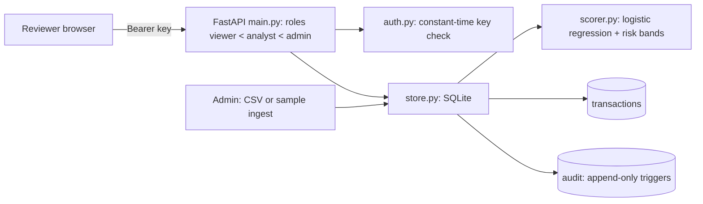

# Architecture

Author: Rayyan Anwar

## Flow
1. **Ingest (admin):** CSV or generated sample rows are validated column by column (timestamps, amount, category, channel, 0/1 flags, counts, duplicate ids). Rejections are counted by reason; accepted rows are scored and banded (high = top 1% of validation-period scores, medium = top 5%) and stored with status `new`. One audit row records the batch.
2. **Review (analyst):** the queue is ranked by score with filters (status, band, channel, category, score, date, customer). A decision changes status along allowed transitions only (`new -> under_review/confirmed/false positive/escalated`; `confirmed_fraud` is final; `false_positive` can be reopened). Decisions need a note, carry the caller's expected status (optimistic concurrency, HTTP 409 on conflict) and write an audit row inside the same SQLite transaction.
3. **Audit (admin):** SQLite triggers abort any UPDATE or DELETE on the audit table; export neutralises spreadsheet formula injection (cells starting with `=`, `+`, `-`, `@`).

## Security notes
Keys are compared in constant time and never logged; reviewer identity comes from the key, not from the request body; all SQL is parameterised and sort columns are whitelisted; uploads capped at 5 MB / 100,000 rows. With `MONITOR_API_KEYS` empty, auth is OFF and everyone is an admin named `local-user`: local demos only.
